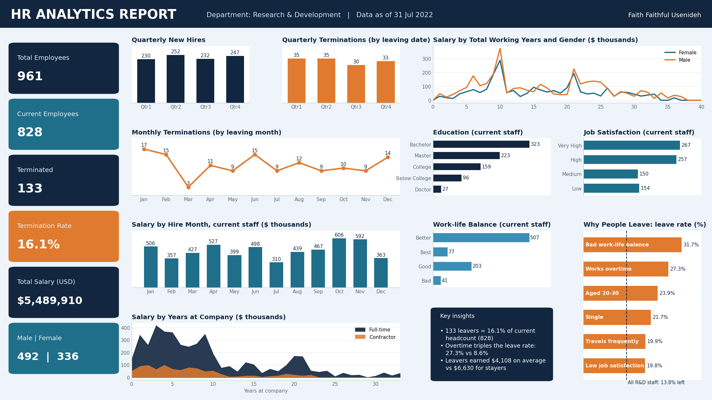

# Why Good People Leave: HR Analytics Dashboard

**Tools:** Microsoft Excel · Power Pivot (data model) · DAX · PivotTables, PivotCharts and Slicers

**Skills shown:** KPI design, DAX measures, dashboard building, data validation, attrition analysis

A company's Research & Development team had 961 people on record. 133 of them were gone. HR wanted a single dashboard to answer 15 questions about headcount, terminations, salary and employee wellbeing.

I built it in Excel, then checked every number against the raw data. That check changed the story: the termination rate was not 25%, and the busiest month for leavers was not July. Then I asked the question the brief didn't: **why are people leaving?**

---

## Dataset
- **Source:** HR employee dataset from a data analytics training brief
- **Size:** 1,470 employees across 3 departments, 38 fields; this report focuses on **Research & Development (961 employees)**
- **Snapshot date:** 31 July 2022
- **Key fields:** Attrition, Department, Gender, Education, JobSatisfaction, WorkLifeBalance, OverTime, Salary, DateStart, DateDeparture, YearsAtCompany, TotalWorkingYears, EmploymentType

## Tools & Functions Used

| Tool / function | What it does in this analysis |
| --- | --- |
| **Power Pivot data model** | Holds the employee table so measures work across every PivotTable |
| `COUNT(Employee[ID_employe])` | DAX: counts total employees |
| `CALCULATE([Total Employee], Employee[Attrition]="No")` | DAX: headcount of current employees |
| `CALCULATE([Total Employee], Employee[Attrition]="Yes")` | DAX: number of terminated employees |
| `[Termination] / [Headcount]` | DAX: termination rate |
| `CALCULATE(SUM(Employee[Salary]), Employee[Attrition]="No")` | DAX: total salary of current staff |
| **PivotTables and PivotCharts** | Group employees by quarter, month, education, satisfaction, gender and tenure |
| **Slicers** | Filter the whole dashboard by department, year and employment type |
| `COUNTIFS`, `SUMIFS`, `AVERAGEIFS` | Formula version of every metric, used to verify the dashboard |
| `MONTH`, `ROUNDUP(MONTH()/3,0)` | Turn hire and leaving dates into months and quarters |
| **Data validation drop-down filters** | Department, Employment type, Gender and Hire year filters; every KPI card and chart recalculates |

---

## Part 1: The headline numbers

| Metric | Result |
| --- | --- |
| Total employees (since inception) | 961 |
| Current employees | 828 |
| Terminated employees | 133 |
| **Termination rate** (terminated ÷ headcount) | **16.1%** |
| Total salary, current staff | $5,489,910 |
| Current staff by gender | 492 male, 336 female |

**What it means:** For every 6 people on the team today, roughly one has already left. At 16.1%, attrition is high enough to cost the company in hiring and lost experience.

## Part 2: When people join and leave

| Quarter | New hires | Terminations |
| --- | --- | --- |
| Qtr1 | 230 | 35 |
| Qtr2 | 252 | 35 |
| Qtr3 | 232 | 30 |
| Qtr4 | 247 | 33 |

Monthly terminations peak in **January (17)**, then **February and June (15 each)**, and drop to just **3 in March**.

**What it means:** Hiring is steady all year, around 230–250 a quarter, so the team grows. But exits cluster at the start of the year, a common time for people to change jobs after annual reviews and bonuses.

## Part 3: Who the workforce is

| Education | Staff | Job satisfaction | Staff | Work-life balance | Staff |
| --- | --- | --- | --- | --- | --- |
| Bachelor's | 323 | Very High | 267 | Better | 507 |
| Master's | 223 | High | 257 | Good | 203 |
| College | 159 | Medium | 150 | Best | 77 |
| Below College | 96 | Low | 154 | Bad | 41 |
| Doctorate | 27 | | | | |

**What it means:** This is a well-educated team, with 66% holding a Bachelor's or Master's degree. Most are satisfied: 63% rate their job satisfaction High or Very High. But 154 current employees report **Low** satisfaction, and 41 report a **Bad** work-life balance. Those are the people most likely to leave next.

## Part 4: Why people leave

This went beyond the brief. I compared the leave rate of different groups against the overall rate of **13.8%** (133 of all 961 R&D staff):

| Group | Leave rate | Compared with |
| --- | --- | --- |
| Bad work-life balance | **31.7%** | 11.8% for "Better" |
| Works overtime | **27.3%** | 8.6% without overtime |
| Aged 20–30 | **23.9%** | 7.0% for ages 40–50 |
| Single | **21.7%** | 8.0% for divorced |
| Travels frequently | **19.9%** | 6.3% for non-travellers |
| Low job satisfaction | **19.8%** | 9.5% for "Very High" |

Leavers also earned far less: an average salary of **$4,108**, against **$6,630** for those who stayed.

**What it means:** People don't leave at random. Overtime alone **triples** the leave rate, and a bad work-life balance makes people almost **three times** more likely to go. The highest risk is young, lower-paid staff working long hours.

---

## How I Checked My Work
Verifying the dashboard against the raw data led me to correct my first version:

1. **Termination rate:** recalculated with the brief's own formula, 133 ÷ 828 = **16.1%**.
2. **Termination timing:** quarterly and monthly terminations now use the **leaving date** (DateDeparture), not the hire date.
3. **Commentary:** education and satisfaction notes now match the R&D figures shown in the charts.
4. **Salary chart:** renamed "Salary by Hire Month", because the data holds annual salary by hire date, not monthly payroll.

The corrected workbook rebuilds every metric with `COUNTIFS` and `SUMIFS`, so each number can be traced back to the raw data.

## Recommendations
1. **Cap overtime.** It is the strongest controllable driver of attrition (27.3% vs 8.6%).
2. **Protect work-life balance.** Reach the 41 staff reporting "Bad" balance first; nearly a third of that group has already left.
3. **Review early-career pay.** Leavers earned about $2,500 less on average than stayers, and staff aged 20–30 leave most.
4. **Act before January.** Run stay interviews and pay reviews in Q4, ahead of the exit peak.
5. **Follow up on low satisfaction.** 154 current employees rate their job satisfaction "Low".

## The Bottom Line
R&D keeps hiring, but it loses 1 person for every 6 it keeps. The data points to **overtime, work-life balance and early-career pay**, all of which the company can change.

## Try It Yourself
Download `HR_Analytics_Dashboard_Corrected.xlsx`, open it in Excel and go to the **Interactive Dashboard** tab. Click any orange filter box at the top, pick an option from the drop-down, and watch the whole dashboard update. For example, choose **Sales + Full-time** to compare a second department.

## Files in this Repository
- `HR_Analytics_Dashboard_Corrected.xlsx`: open the **Interactive Dashboard** tab and use the four orange filters (Department, Employment, Gender, Hire year); every KPI card and chart updates. Also includes the formula-based Analysis sheet, the full dataset and a Notes sheet listing each correction.
- `HR_Dashboard.png`: dashboard image
